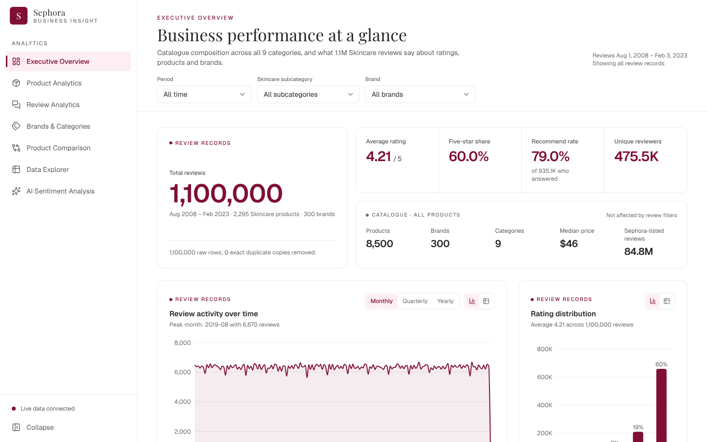
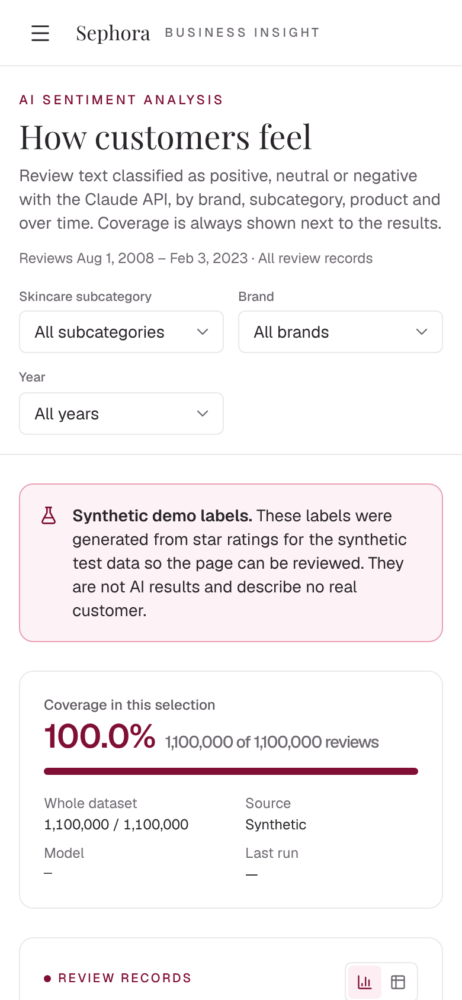
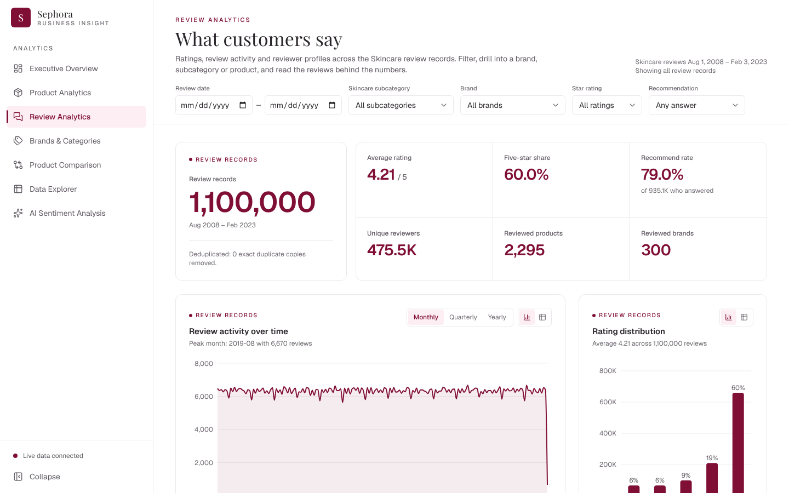
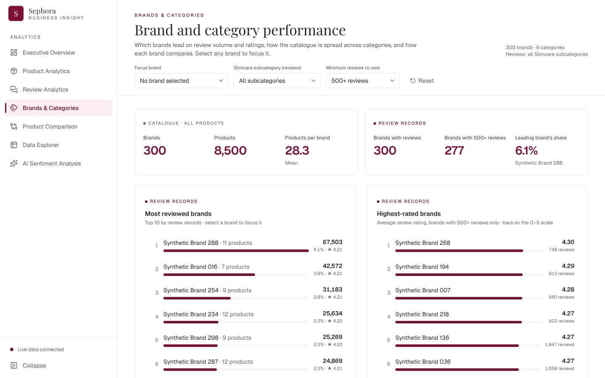
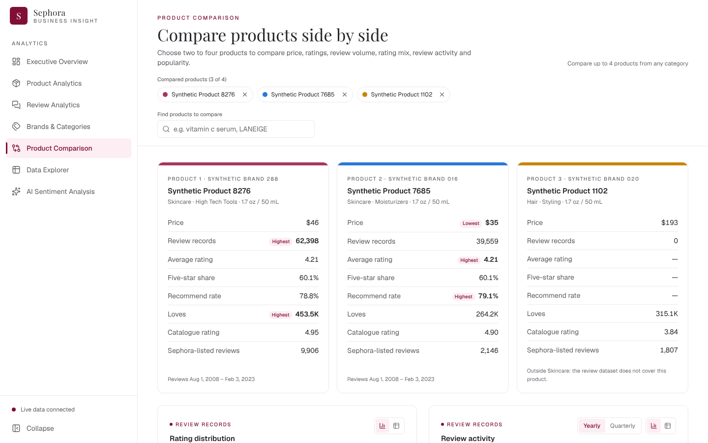
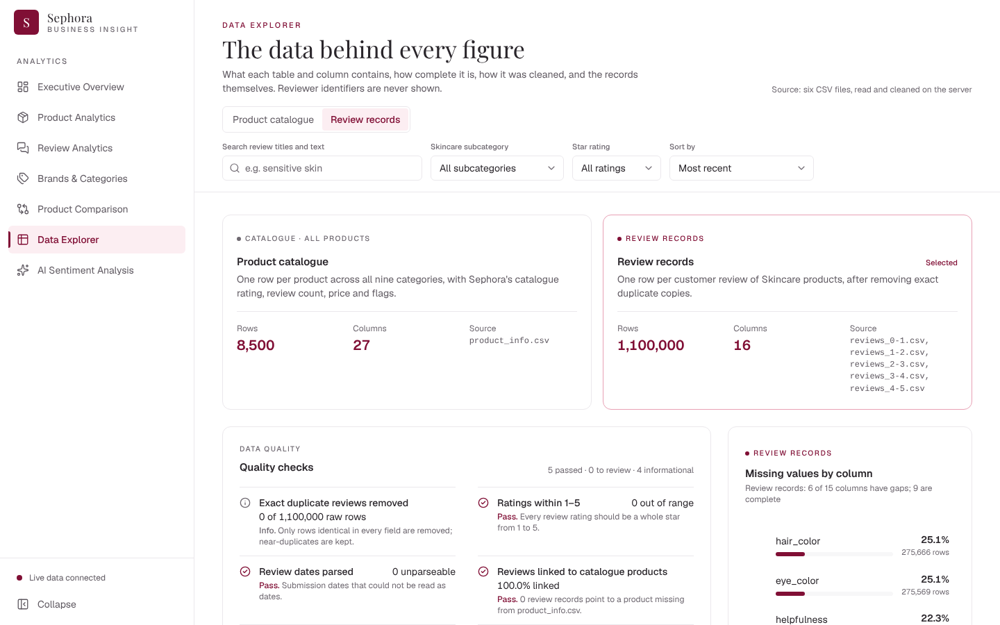
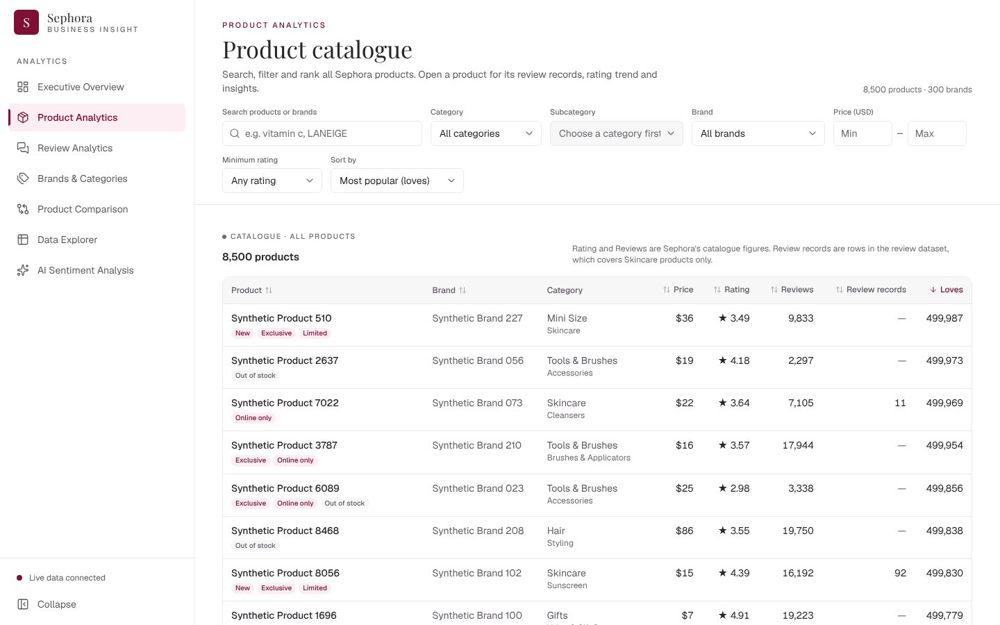
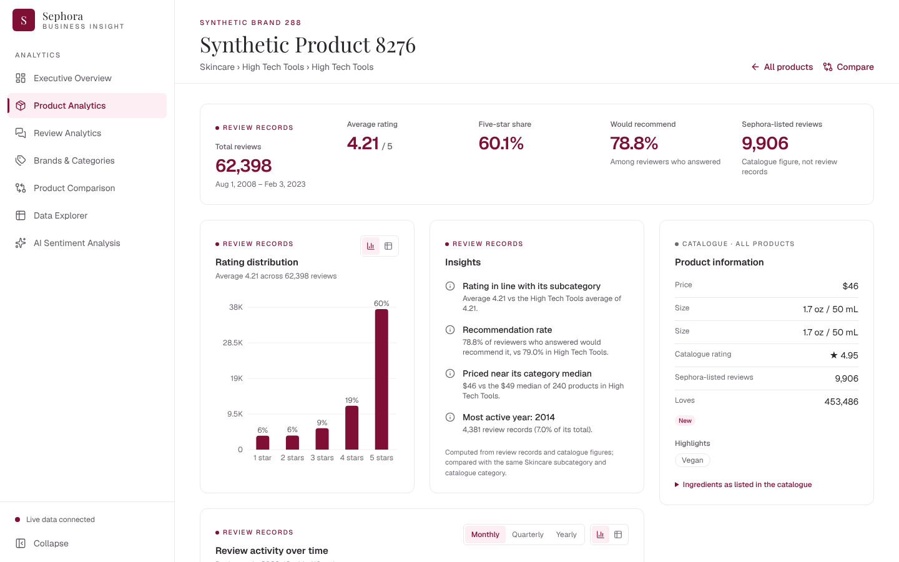
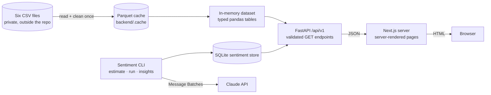
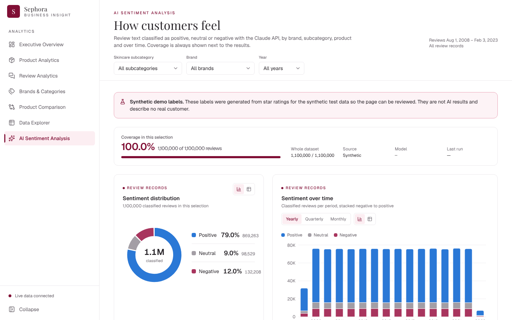

# Sephora Business Insight

A business-intelligence platform for the Sephora product catalogue and its Skincare customer
reviews: executive KPIs, product, review, brand and category analytics, side-by-side product
comparison, a documented data explorer and AI sentiment analysis, built on a typed FastAPI
backend and a server-rendered Next.js frontend.



> **About the screenshots.** Every screenshot in this README was taken against a **synthetic**
> dataset with the real CSV schema (random "Synthetic Product / Synthetic Brand" records, see
> [Benchmarking](#benchmarking-at-full-scale)). The original Sephora data is private and is never
> committed or shown here.

## Contents

- [Business problem](#business-problem)
- [Features](#features)
- [Technology stack](#technology-stack)
- [Architecture](#architecture)
- [Dataset](#dataset)
- [Installation](#installation)
- [Environment variables](#environment-variables)
- [AI sentiment analysis](#ai-sentiment-analysis)
- [API](#api)
- [Testing](#testing)
- [Security](#security)
- [Performance](#performance)
- [Project status and limitations](#project-status-and-limitations)

## Business problem

A beauty retailer holds two very different sources of truth: a catalogue of thousands of
products across nine categories, and over a million customer reviews for its Skincare range.
Category managers and merchandisers need to answer questions such as:

- Which products, brands and subcategories drive review volume, and how satisfied are customers?
- Which highly rated brands are rated on enough reviews to be trusted?
- How do two to four candidate products compare on price, ratings, activity and popularity?
- What do customers *say* (not only how many stars they give), and where is sentiment worsening?
- How complete and trustworthy is the data behind each number?

Sephora Business Insight answers these with interactive, filterable dashboards that keep
catalogue figures and review figures strictly apart, label the source of every number, and never
invent data.

## Features

| Page | What it offers |
| --- | --- |
| **Executive Overview** `/` | Review KPIs (records, average rating, five-star share, recommend rate, unique reviewers), catalogue KPIs, review activity over time, rating distribution, top products and brands, average rating by Skincare subcategory, a year × month activity heatmap, catalogue category mix, price distribution and a rating-vs-popularity scatter. Period, subcategory and brand filters in the URL. |
| **Product Analytics** `/products`, `/products/[id]` | Catalogue explorer with search, category → subcategory, brand, price and rating filters, sortable columns and server-side pagination. Product pages show catalogue facts, review statistics, rating distribution, review trend, paginated customer reviews and rule-based insights that restate computed figures. |
| **Review Analytics** `/reviews` | Review KPI cards, activity over time, rating distribution, reviews by brand and subcategory with drill-down, most reviewed products, aggregate reviewer profiles (self-reported skin type, tone, eye and hair colour) and a searchable, sortable, paginated review explorer. Date, subcategory, brand, product, rating and recommendation filters. |
| **Brands & Categories** `/brands` | Most reviewed and highest-rated brands (with a minimum review count so small samples never top a ranking), a brand landscape scatter, products by category with drill-down, product counts by brand, average rating by subcategory, a brand focus panel comparing a brand with all brands, and a searchable brand directory. |
| **Product Comparison** `/compare` | Two to four products from any category: side-by-side cards marking clear leaders, rating distribution, review activity on a shared timeline, popularity and sentiment where available. Shareable via the URL. |
| **Data Explorer** `/explorer` | Row and column counts, a column dictionary (type, description, missing values, value summary), missing values by column, data-quality checks computed from the data, the cleaning steps, and a server-side record browser for both tables. |
| **AI Sentiment Analysis** `/sentiment` | Positive / neutral / negative sentiment of review text classified with the Claude API: coverage, distribution donut, sentiment over time, breakdown by brand, subcategory or product, and evidence-backed insights. See [AI sentiment analysis](#ai-sentiment-analysis). |

Common to every page: filters and sorting live in the URL (shareable, server-rendered), every
chart has a table view, tooltips and an empty state, loading skeletons, per-section error states,
and a layout that works from 390 px phones (drawer navigation) to wide desktops.

<p align="center"></p>

<table>
  <tr>
    <td></td>
    <td></td>
  </tr>
  <tr>
    <td></td>
    <td></td>
  </tr>
  <tr>
    <td></td>
    <td></td>
  </tr>
</table>

**Design system:** white-dominant surfaces, burgundy `#800F35` for emphasis and data marks,
soft pink `#FCEEF2` and elegant pink `#E8A0B4` for selection and highlights, light grey `#F7F7F8`
and charcoal `#29252A`. Playfair Display for editorial headings, Geist for figures and tables.
Text colours meet WCAG AA; categorical chart colours (product comparison) were checked with a
colour-vision-deficiency palette validator; sentiment uses a diverging encoding with a neutral
grey midpoint; status and identity are never shown by colour alone.

## Technology stack

| Layer | Technology |
| --- | --- |
| Frontend | Next.js 16 (App Router, server components), React 19, TypeScript, Tailwind CSS 4, Recharts 3, lucide-react |
| Backend | Python 3.12+, FastAPI, Pydantic 2, Pandas 3, NumPy, PyArrow (Parquet cache), SQLite (sentiment labels) |
| AI | Anthropic Python SDK, Claude Message Batches API with structured JSON output |
| Data | Six CSV files as the single source of truth (no database server) |
| Quality | pytest, ruff, Vitest + Testing Library, ESLint, TypeScript, pip-audit, npm audit; browser checks with Playwright during development (not part of CI) |
| CI | GitHub Actions: repository safety check, backend lint + format + tests + audit, frontend lint + typecheck + tests + build |

## Architecture



- **Data layer** (`backend/app/data`): reads the CSVs once, removes exact duplicate reviews,
  assigns each review a stable content-hash `review_id`, converts text to categories and small
  integers, and writes a Parquet cache that is rebuilt automatically when a source file changes.
  Later starts load the cache in well under a second.
- **Services** (`backend/app/services`): vectorised analytics (NumPy `bincount` over category
  codes) with a bounded in-memory result cache. Review filters are shared by every review-based
  endpoint; catalogue figures are never affected by them.
- **API** (`backend/app/api`, `schemas`): one validated query model per endpoint (unknown
  parameters rejected, bounded values, whitelisted sort fields) and typed response models
  mirrored in `frontend/src/lib/api/types.ts`.
- **Frontend** (`frontend/src`): App Router pages render on the server from the URL state; the
  browser never calls the API directly. Client components handle interaction and update the URL.

```
backend/
  app/            api/ core/ (settings, rate limiting) data/ schemas/ services/ sentiment/ main.py
  scripts/        benchmark, real-data validation, synthetic dataset generator
  tests/          pytest suite, synthetic fixtures, independent csv-module oracle
frontend/src/
  app/            one folder per page (page.tsx + loading.tsx)
  components/     layout, ui, charts and one folder per feature
  lib/            typed API client, URL-state modules, formatting, theme, navigation
docs/screenshots/ README screenshots (synthetic data only)
scripts/          repository safety check (CI)
```

## Dataset

The Sephora products and Skincare reviews dataset: one catalogue file (`product_info.csv`) and
five review files (`reviews_*.csv`).

| Table | Rows | Scope |
| --- | --- | --- |
| Product catalogue | 8,494 products, 304 brands | All nine primary categories (Skincare, Makeup, Hair, Fragrance, …) |
| Review records | 1,094,187 after removing exact duplicates; average rating ≈ 4.30 | Skincare products only |

These figures were verified earlier against the real files; `scripts/validate_against_csv.py`
re-checks the API against an independent `csv`-module oracle locally. The application computes
every figure from the data and hard-codes none.

Data rules applied throughout:

- **Catalogue charts** may use all nine categories; **review-based category analytics** use
  Skincare subcategories, because the review files only cover Skincare.
- Sephora's own catalogue `reviews` column is shown as **"Sephora-listed reviews"** and never mixed
  with review-record counts (field names: `review_count` / `review_record_count` vs
  `sephora_review_count`).
- Only **exact** duplicate review rows are removed; near-duplicates are kept.
- The reviewer `author_id` is used only to count distinct reviewers and is **never returned**.
- The [Data Explorer](#features) documents every column, its completeness and the quality checks.

## Installation

Prerequisites: Python 3.12+, Node.js 24+, npm, and the dataset folder (`product_info.csv` and
`reviews_*.csv`) **outside** the repository. Commands below are for Windows PowerShell; on macOS
or Linux use `.venv/bin/python` and `cp`.

**Backend**

```powershell
cd backend
python -m venv .venv
.venv\Scripts\python -m pip install -r requirements-dev.txt
copy .env.example .env    # then set SBI_DATA_DIR to your dataset folder
.venv\Scripts\python -m uvicorn app.main:app --reload --port 8000
```

API docs: http://127.0.0.1:8000/docs · health: http://127.0.0.1:8000/api/v1/health.
The first start reads the CSVs (about 20–35 s) and writes the Parquet cache; later starts load it
in under a second. `python -m app.data.build_cache [--force]` pre-builds or rebuilds it.

**Frontend**

```powershell
cd frontend
npm install
copy .env.example .env.local
npm run dev               # http://localhost:3001
```

Production: `npm run build` and `npm start`; run the API with `SBI_ENVIRONMENT=production`.

## Environment variables

Backend (`backend/.env`, see `backend/.env.example`; never commit `.env`):

| Variable | Default | Purpose |
| --- | --- | --- |
| `SBI_DATA_DIR` | `<repo>/data` (gitignored) | Folder with the six CSV files; a folder outside the repository is safest |
| `SBI_CACHE_DIR` | `backend/.cache` | Parquet cache and sentiment store (derived private data, gitignored) |
| `SBI_CACHE_ENABLED` | `true` | Use the Parquet cache |
| `SBI_CACHE_VERIFY_HASH` | `false` | Also compare SHA-256 of the CSVs when validating the cache |
| `SBI_PRELOAD` | `false` | Load the dataset at start-up instead of on the first request |
| `SBI_ENVIRONMENT` | `development` | `production` disables the interactive API docs |
| `SBI_CORS_ORIGINS` | `["http://localhost:3001","http://127.0.0.1:3001"]` | Allowed browser origins (JSON list) |
| `SBI_RATE_LIMIT_PER_MINUTE` | `300` | Requests per minute per client; `0` disables rate limiting |
| `SBI_RATE_LIMIT_BURST` | `100` | Burst size of the per-client token bucket |
| `SBI_RATE_LIMIT_EXEMPT` | `[]` | Client addresses never limited, e.g. the Next.js server in production (JSON list) |
| `SBI_TRUST_PROXY_HEADERS` | `false` | Use `X-Forwarded-For` for the client address; only behind a trusted proxy |
| `ANTHROPIC_API_KEY` | — | Claude API key for the sentiment CLI only; never sent to the browser |
| `SBI_SENTIMENT_MODEL` | `claude-opus-5-5` | Model used for classification |
| `SBI_SENTIMENT_EFFORT` | `low` | Effort level for classification requests |
| `SBI_SENTIMENT_GROUP_SIZE` | `20` | Reviews per classification request |
| `SBI_SENTIMENT_DB` | `<SBI_CACHE_DIR>/sentiment.sqlite3` | Sentiment label store |

Frontend (`frontend/.env.local`):

| Variable | Example | Purpose |
| --- | --- | --- |
| `NEXT_PUBLIC_API_BASE_URL` | `http://127.0.0.1:8000` | Base URL of the FastAPI backend |

## AI sentiment analysis

Sentiment classification is deliberate, paid work, so it runs **only from the command line** on
the machine that holds the data. The web API only reads stored results and has no endpoint that
can start it. Until reviews are classified, the Sentiment page shows how to start and no figures.

```powershell
cd backend
.venv\Scripts\python -m app.sentiment.cli estimate --sample 2000                 # free: token counting only
.venv\Scripts\python -m app.sentiment.cli run --sample 2000 --max-cost 3 --yes   # pilot
.venv\Scripts\python -m app.sentiment.cli status
.venv\Scripts\python -m app.sentiment.cli estimate                               # the rest
.venv\Scripts\python -m app.sentiment.cli run --max-cost <ceiling> --yes
.venv\Scripts\python -m app.sentiment.cli insights --max-cost 0.50 --yes         # optional AI insights
```

- **Cost control:** a run needs `--yes` and a `--max-cost` at or above the upper estimate, and it
  stops before any batch chunk that could cross the ceiling. Estimates use the free token-counting
  endpoint; after a run they use the measured output tokens. Prices for the estimate live in
  `backend/app/sentiment/pricing.py`.
- **Batching and caching:** requests go through the Message Batches API (50% of standard price),
  about 20 reviews per request, with a strict JSON-schema output. Labels are stored in SQLite,
  keyed by review, with the model and prompt version, so no review is paid for twice.
- **Retries and honesty:** failed, refused or incomplete groups are split and retried; reviews that
  still fail stay unclassified. Nothing is guessed, and coverage is shown next to every result.
- **Prompt safety:** reviews are sent as JSON data, the prompt tells the model to ignore
  instructions inside reviews, and internal IDs are never sent.
- **Insights:** computed insights restate figures with their evidence; AI-written insights are
  generated from those computed figures only (never raw reviews) and must cite them.
- **Synthetic demo labels:** `seed-synthetic` labels the synthetic test fixtures from their star
  ratings so the page can be reviewed without an API key. It refuses on any dataset larger than
  the fixtures, and such labels are marked as synthetic everywhere.



## API

All endpoints are `GET` under `/api/v1`; interactive documentation is served at `/docs` outside
production.

| Endpoint | Data | Purpose |
| --- | --- | --- |
| `/health` | — | Liveness and dataset status (never loads data) |
| `/overview`, `/filters` | both | Dataset summary; values for filter controls |
| `/kpis` | both | Executive KPIs; review figures follow review filters, catalogue figures never do |
| `/reviews/rating-distribution` | reviews | Count and share per star rating |
| `/reviews/trends?granularity=month\|quarter\|year` | reviews | Volume and rating over time (gaps zero-filled) |
| `/reviews/activity-heatmap` | reviews | Year × month review counts |
| `/reviews/profiles` | reviews | Aggregate reviewer attributes |
| `/reviews`, `/reviews/{review_id}` | reviews | Review explorer (filters, literal text search `q`, sort, paging); one review |
| `/products/top-reviewed`, `/products/top-by-year?year=` | reviews | Most reviewed products, overall or in a year |
| `/products/review-years`, `/products/rating-popularity` | reviews | Years with reviews; rating vs volume vs loves |
| `/products/compare?product_id=…` | both | 2–4 products side by side with review activity per year or quarter |
| `/products`, `/products/{product_id}` | catalogue (+ reviews) | Catalogue search, filters, sort, paging; product detail |
| `/brands`, `/brands/top` | both | Brand directory; top brands by review volume |
| `/brands/review-stats?min_reviews=&sort_by=` | reviews | Per-brand review statistics above a minimum review count |
| `/brands/detail?brand=` | both | One brand by exact name |
| `/categories/catalogue[?parent=&brand=]` | catalogue | Category or subcategory breakdown, optionally for one brand |
| `/categories/reviews` | reviews | Skincare subcategory breakdown |
| `/prices/distribution` | catalogue | Price histogram with overflow bin and statistics |
| `/dataset/profile` | both | Column dictionary, missing values and quality checks (aggregates only) |
| `/sentiment/summary`, `/sentiment/breakdown`, `/sentiment/trends`, `/sentiment/insights` | reviews | Stored sentiment: coverage and distribution, per-group breakdown, trend, insights |

**Review filters** (all review-based endpoints): `date_from`, `date_to` (inclusive), `brand`,
`subcategory`, `product_id`, `rating`, `skin_type` (repeat a parameter for several values),
`recommended`. **Paging:** `page`, `page_size` (1–100); responses include `total` and
`total_pages`. Sorting uses whitelisted `sort_by` fields with `order=asc|desc` and a deterministic
tie-break. Unknown parameters and out-of-range values return `422`; too many requests return
`429` with `Retry-After`.

## Testing

```powershell
cd backend;  .venv\Scripts\python -m pytest; .venv\Scripts\python -m ruff check .; .venv\Scripts\python -m ruff format --check .
cd frontend; npm test; npm run lint; npm run typecheck; npm run build
bash scripts/check-tracked-files.sh
```

- **Backend:** pytest over small synthetic fixtures with hand-counted expected values, an
  independent `csv`-module oracle, endpoint, validation and security tests, rate-limit tests, and
  sentiment tests against a fake batch backend (no test calls the Anthropic API).
- **Frontend:** Vitest + Testing Library for URL-state parsing and validation, components,
  filters, drill-down links, pagination and accessibility details.
- **CI:** every pull request runs the safety check, backend lint/format/tests/`pip-audit` and
  frontend lint/typecheck/tests/build.
- **Real data (local only):** `python -m scripts.validate_against_csv` compares the API with the
  oracle on the real files; `SBI_VALIDATE_REAL_DATA=1 pytest tests/test_realdata.py`.

## Security

- **Private data stays private:** the CSVs, caches, SQLite stores and `.env` files are gitignored,
  and `scripts/check-tracked-files.sh` (in CI) fails the build if data files, environment files,
  keys or secret-looking strings are tracked.
- **Read-only, validated API:** `GET` only; strict query models; literal (never regex) search;
  reviewer identifiers never returned; error responses never echo file paths.
- **Rate limiting:** per-client token bucket (300 requests per minute, burst 100 by default);
  text search and the dataset profile cost five tokens. In production, exempt the Next.js server
  (`SBI_RATE_LIMIT_EXEMPT`) because pages are rendered there.
- **Headers:** restrictive CORS; API responses carry `Content-Security-Policy: default-src 'none'`,
  `nosniff`, `DENY`, `no-referrer` and `no-store`; the frontend sends a Content-Security-Policy with
  no third-party origins, `X-Frame-Options`, a referrer and a permissions policy, and no
  `X-Powered-By`.
- **AI:** the API key is read only by the backend CLI (`SecretStr`, never logged or returned); no
  endpoint can start paid processing; synthetic labels can never be written for the real dataset.
- **Dependencies:** `pip-audit` and `npm audit` are clean at the time of writing.

## Performance

The application is designed for the full dataset: a Parquet cache, compact column types,
vectorised aggregations, cached results, server-side filtering and pagination (the browser never
receives the review table), debounced searches and server-rendered pages.

### Benchmarking at full scale

`scripts/make_synthetic_dataset.py` writes a random dataset with the real CSV schema (no Sephora
data) outside the repository, so performance can be measured without the private files:

```bash
cd backend
python -m scripts.make_synthetic_dataset /tmp/sbi-synthetic --reviews 1100000
SBI_DATA_DIR=/tmp/sbi-synthetic SBI_CACHE_DIR=/tmp/sbi-synthetic-cache python -m scripts.benchmark --rebuild
```

Measured on 1.1M synthetic reviews in a 4-core cloud container: the dataset opens from the cache
in 0.15 s, most endpoints answer in under 10 ms once warm, and every page loads in 0.6–1.7 s in a
browser with cold caches. Hot spots found by profiling, and their fixes:

| Endpoint | Before | After |
| --- | --- | --- |
| `/sentiment/summary`, first call after a classification run | 3,300 ms | 1,624 ms (27 ms after a restart) |
| `/sentiment/breakdown` | 335 ms on every call | 26 ms first, 6 ms cached |
| `/sentiment/insights` | 674 ms on every call | 69 ms first, 6 ms cached |
| `/dataset/profile`, first call | 2,829 ms | 907 ms |

Synthetic review text is shorter than real reviews, so text-heavy paths (search, the first
profile request) may be slower on the real data; run `python -m scripts.benchmark` locally to
measure.

## Project status and limitations

- **Complete:** all seven pages, the API, the data pipeline, the sentiment integration and the
  safeguards described above, with automated tests and CI.
- **AI sentiment is ready but not yet run:** no reviews have been classified with Claude yet.
  Running it needs an Anthropic API key and an approved budget (see
  [AI sentiment analysis](#ai-sentiment-analysis)); until then the Sentiment page shows how to
  start, and Product Comparison shows no sentiment.
- **Real-data checks are local:** CI uses synthetic fixtures. The verified dataset figures above
  come from local validation against the real files.
- The rate limiter keeps its counters in memory per process; a multi-instance deployment would
  need a shared store such as Redis.
- The frontend Content-Security-Policy allows inline scripts and styles (needed by Next.js and the
  charts); a nonce-based policy would remove that at the cost of fully dynamic rendering.
